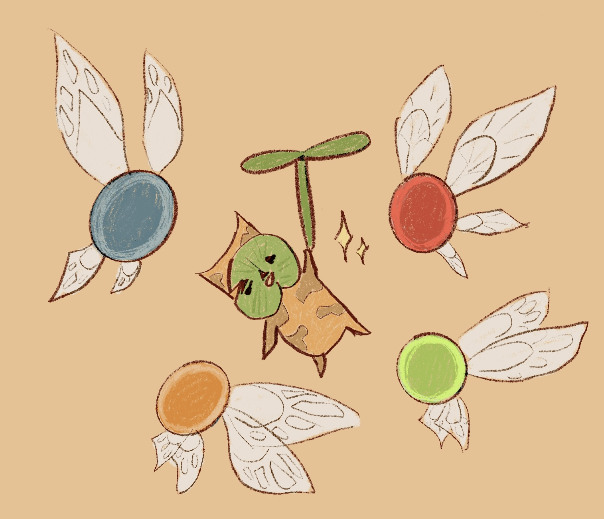

# Squadala!

Squadala! - online co-op for the Ocarina of Time remake on PC. (The repository keeps its name, `oot-remake-multiplayer`.)

The goal of this project is working multiplayer in two stages:

1. **Emulator first.** Add co-op to the Lichii emulator (Frizti's build), where the game already runs well. Up to 16 players see each other in the world, share progress, and fight the same enemies.
2. **Then a recomp.** Carry the same co-op design into a native PC recompilation of the game. This is where releases are now: since 0.10.1 they run on [Longshot](https://git.magicbean.dev/MagicBeanDev/Longshot) (Team MagicBean's recompilation of the game, whose changes are being merged into [Hookshot](https://git.notrexed.dev/Hookshot/Hookshot)) or [nxnative](https://github.com/seedds/nxnative), with the same code, protocol and server. For 1.0, co-op is meant to ship as an add-on mod for the recomp rather than a patched build of our own.

Both stages share one design, one wire protocol and one server, so what is learned on the emulator carries straight over to the recomp.

**Discord:** the Squadala! server, https://discord.gg/GwtRKAqng5, for players, testers and contributors. Found a bug? Type `/bugreport` there and attach the zip from `scripts\collect-logs.cmd` ([how](docs/setup.md#reporting-a-problem)).

## Play the newest release

**[Squadala! v0.11.4](https://github.com/daurosk/oot-remake-multiplayer/releases/tag/v0.11.4)** is the newest build (the releases are pre-releases, which GitHub's "latest" link skips; the [releases page](https://github.com/daurosk/oot-remake-multiplayer/releases) lists them all). It runs on [Longshot](https://git.magicbean.dev/MagicBeanDev/Longshot) v3.0.0-rc.7 (Team MagicBean and contributors, GPL-3.0; its changes are being merged into [Hookshot](https://git.notrexed.dev/Hookshot/Hookshot) by NotRexed and contributors), a native PC version of the game that the kit builds on your PC from your own copy. Longshot is the version we build on until something better is out.

**New here?** Download `Squadala-v0.11.4-windows.zip` (Linux and Steam Deck, experimental: `Squadala-v0.11.4-linux.zip`, see [setup-linux.md](docs/setup-linux.md)), unzip it to a short folder such as `C:\Squadala`, and double-click **Start Squadala.bat**. The first time it asks for your game file (drag your `.nup` into the window) and builds the game from it: 10 to 45 minutes and about 60 GB free, once; it also makes the puppet pack from your own game files by itself. Then **Host** or **Join** in the game's menu, **Multiplayer** tab (see below). It needs 64-bit Windows, a graphics card with mesh shaders (NVIDIA RTX 20 or newer, AMD RX 6000 or newer) and 16 GB of RAM. Each player needs their own copy of the game. Full steps: **[setup.md](docs/setup.md)**.

**Emulator players:** this release has no emulator. Keep playing on the last emulator release, the early test release of 2026-11-12 on the [releases page](https://github.com/daurosk/oot-remake-multiplayer/releases) (it cannot join a Longshot game). To move to Longshot, unzip the 0.11.0 kit into a new folder rather than updating the emulator kit.

**Opening the Multiplayer tab:** on a controller press **−** and **+** together (on an Xbox-style pad **View** and **Menu**), or **Home**; on the keyboard **F1** (Insert and Esc also open it unless you changed that in the menu); on the title screen **−** alone. The Multiplayer tab is the first one; the D-pad or the arrow keys choose, A or Enter confirms, B or Esc goes back.

**Already have a kit?** A 0.11.3 kit offers the update when you start it; or download **Update.bat** from the release page into your kit folder and double-click it. A kit older than 0.11.3 updates to 0.11.3 first and to 0.11.4 on the next start, or goes straight to 0.11.4 with **Update.bat**. 0.11.4 builds the game again once (Longshot v3.0.0-rc.7: 10 to 45 minutes). The kit starts with **Start Squadala.bat** only; the update moves your shortcuts over from the old `Start OoT Co-op.bat`. It is still protocol 12, but most fixes need every player on 0.11.4: update together. **Revert.bat** in the kit folder goes back to the version you had before (everyone you play with needs the same one).

**New in 0.11.4 (game rebuild on Longshot v3.0.0-rc.7):** down, not out: at zero hearts you crawl, a teammate holds A beside you to revive you, and if nobody does you watch a teammate until the fight is over; enemies and bosses go after every player by the game's own rules, so Gohma no longer chases the host only (#150); Longshot's Skip title screen is safe in co-op (off by default); Nucleus split screen can let online players join; the difficulty's extra enemies inside dungeons again; OOTRR 0.6.2; `/bugreport` on the Discord and a problem-report script (thanks to TheProjectNavi); and, not yet checked in a game: Gold Skulltula tokens taken once for everyone (#89, thanks to cirnoice9), a crash when a second player joins, boss deaths and beaten bosses for everyone, Deku Tree and Jabu-Jabu switches in every game (#176, #129), the Fire Temple pillar (#116), Business Scrubs (#253), Great Fairy rewards (#244), moving platforms (#194). Full list: [the release notes](https://github.com/daurosk/oot-remake-multiplayer/releases/tag/v0.11.4).

**New in 0.11.3 (hotfix, no game rebuild from 0.11.2):** items from a guest's old save no longer leak into the host's new file when the guest joins or loads from the title; freeing a Gerudo Fortress carpenter counts for everyone (#252); the ocarina someone else got from Saria plays for everyone right away, with no save-and-reload (#190); no crash at the start with a randomizer seed from OOTRR's website or another mod whose folder sorts before the co-op files, and the other players show as usual; OOTRR 0.6.1 (start a new randomizer save); skin mods with their own size table no longer turn the other players' Links off (checked by tests only); a step-by-step [randomizer guide](docs/randomizer.md). Full list: [the release notes](https://github.com/daurosk/oot-remake-multiplayer/releases/tag/v0.11.3).

**New in 0.11.2 (bug fixes from your reports, game rebuild; many not yet checked in a game, see the release notes):** the Gohma softlock after her intro; bosses that only one player could hurt, that could not be stunned, did not die for everyone or ignored the difficulty (on Automatic, more boss life per player), and the blue warp for guests; Mido still blocking Kokiri Forest after the Deku Tree (a stuck save is mended); the Threads of Time and Door of Time, Zora's waterfall, the shared ocarina and both letters for players who were not there; small-key doors, the Dodongo's Cavern Lizalfos door, carrying Ruto and Jabu-Jabu's lifts in every game; smoother enemies on slow connections; missing Deku Nut and stick effects; a crash when a player takes out the Hookshot (#232, thanks to cirnoice9); your own colours blinking in cutscenes; IP address, Port and Password rows for joining (thanks to bmitch87); the whole co-op interface in Chinese (thanks to cirnoice9); a Microphone row; Linux saves, pads, colours and typing (thanks to StarAppeal); Nucleus controllers; adult Link's live 3D preview in Customize; kit windows that no longer pause on a click and a game-file question that takes a pasted path; randomizer seeds with settings from OOTRR's website. Full list: [the release notes](https://github.com/daurosk/oot-remake-multiplayer/releases/tag/v0.11.2).

**New in 0.11.1 (hotfix, no game rebuild):** customization fixes (everyone no longer wears the host's colour; the Kokiri keep their own; adult Goron and Zora tunics), the rupee flood (and the lag and missing effects it caused), randomizer seeds that hid the other players or crashed, other players stuck in one pose, moving platforms during a pause, a PvP hit on a downed player, Gold Skulltula tokens counted twice, Join's code field (paste replaces, Clear), download retries with a mirror, the puppet pack made again when needed, and collect-logs zips. Full list: [the release notes](https://github.com/daurosk/oot-remake-multiplayer/releases/tag/v0.11.1).

**New in 0.11.0:** **Customize Link** in the Multiplayer tab: your tunic and gear colours (shields, swords, boots, gauntlets), on your own Link and on the others' screens; the **randomizer** built in (below); the other players' Links move smoothly (an even game-frame clock for them and for the townspeople copied from another game) with their sword in their hand; the dungeon map no longer vanishes from the minimap and the other players show on it; the host's time of day is everyone's (#192); difficulty set by the host or by the number of players, and helping up a player at zero hearts; the Kakariko gate and Zelda's Letter now go through the game's own quest steps (#171) and the Kakariko graveyard's Poe and the gravestones players push are shared (both new, tell us how they go); extra enemies no longer stand on one spot; Revert.bat; Chinese text for the Multiplayer tab (thanks to cirnoice9).

**Randomizer:** [OOTRR](https://github.com/REALAZK/ootrr) 0.6.2 by REALAZK comes with the kit since 0.11.4 (0.11.3 had 0.6.1, 0.11.2 had 0.6.0, 0.11.1 had 0.5.0; the kit downloads it during the build): Mods tab, **OoT Remake Randomizer**, **Settings**, turn **Randomizer** on. In co-op the host's seed is everyone's: each guest's game builds it by itself. The host and every guest need the same co-op release, so they also have the same OOTRR. Do not install OOTRR by hand next to co-op (a second copy of OOTRR crashed the game at start with 0.5.0); the kit's own is enough ([mods.md](docs/mods.md#the-randomizer)). Step by step for co-op (switch on, wait, restart, new save; each guest builds and restarts too): [docs/randomizer.md](docs/randomizer.md).

**Split screen (experimental):** two full games on one PC with [Nucleus Co-op](docs/play-lan.md#split-screen-experimental), one per player, each with its own controller (about 10 GB of RAM per player and a strong graphics card). Native split screen (one game) comes in a later release.

1. [Setting up](docs/setup.md): the start file, the first build, updating, settings and troubleshooting.
2. Play on the [same network (LAN)](docs/play-lan.md), or [over the internet](docs/play-online.md): Host in the Multiplayer tab opens the port on your router by itself (UPnP), makes a random join password and copies an **invite code** (share it in DMs only: it holds your internet address); friends paste it under Join. Every session has a join password, and all game traffic is encrypted with it.
3. [Known issues](docs/known-issues.md): what works in this build and what does not yet.
4. [Questions testers ask](docs/faq.md): who is the host, a permanent server, shader stutter, where saves are.

What works in it: the other players as Link (child and adult) with Navi and a name tag, following them live, with their sword, shield, held items and gear (#91, #92); shared items, songs, keys, heart pieces and heart containers; a shared Slingshot or ammo bag comes with its seeds and room (#128); projectiles others make are shown both ways: slingshot seeds and arrows in flight, nuts, bombs and the hookshot (#85, #158); a bomb another player holds stays in their hands with its fuse blinking and explodes on every screen at once (#169); dungeon progress and room switches (#129); boss rooms entered together, and a player who walks out during the fight is pulled back in (#109); shared enemies, townspeople and Stalchildren (#124), all Deku Babas (#132); the host's save decides (a host's load resets the group, a guest's load takes the group's progress); guests who join from the title get the host's save (#167); chat, a player list, reconnects (also over VPNs such as Hamachi, #143) and rejoining after a crash; a join password with a lockout for repeated wrong guesses (#160); `collect-logs` masks addresses and names (#172); the updater adds new settings (#179); `/teleport <name>` moves you to another player (#156); the pause menu's **Multiplayer** tab with Host, Join, Leave, Customize Link, Settings and a Commands page; proximity voice chat (off by default; turned on it is open mic, or push to talk with **V** in Settings); playing solo (the game starts with no session). Texture and model mods work; when your mods differ from the host's, the chat says so and the Mods tab lists what differs ([mods.md](docs/mods.md#mods-in-co-op)).

**Saves: the host's save decides.** Progress is shared while you play; when the host loads a save, every game goes back to that save's progress, and a guest who loads a save gets the host's. To undo something, the host loads an older save; if the host restarts and loads, the guests' progress since the host's last save is undone. See [Playing from the host's save](docs/play-online.md#playing-from-the-hosts-save).

Known issues of this build: the Hylian Shield's frame looks much darker than the colour picked in Customize; another player's ocarina shows upside down, and with 5 or more players or the Giant's Knife their sword can show without its blade; the Deku Tree switches (#176, #129) are fixed in 0.11.4 but not yet checked in a game: tell us if a lift still moves in one game only; on Linux the away/paused state, the Map page and the HUD refresh do not work yet (#150, fixed for the next release); the graveyard's shared Poe and gravestones are new and not yet seen in a two-player game;  other players' ocarina notes are built in but not yet heard in our tests (#152); a kit from before 0.10.1 needs the release's `Update.bat` to update; Microsoft Defender may warn about the zip or `Update.bat` (a false alarm on the scripts); others' masks and boots not yet seen on the other screen (#91); the spark where another player's shot hits does not show (#166); only game version 1.1.1 is checked (#97); shader stutter in new places the first time. See [Known issues](docs/known-issues.md) and the release notes.

**Safety.** Only the host opens a port: UDP 27510 for the co-op server; players who join open nothing. With the invite code, the game asks the host's router (UPnP) to forward that one port only while the server runs; it removes the mapping when the server stops. Every session has a join password: random for each start (unless the host sets one), never written to the logs, and the hole-punch messages are signed with it; the game traffic is always encrypted with it (X25519 and XChaCha20-Poly1305), so nobody on the path can read or change it. The server and the games check every message against fixed limits and never write where a message says, and the updater downloads only this project's releases over HTTPS and checks their signature and SHA-256. Share an invite code only with friends: it holds your address and the password, and it stops working when hosting stops. `upnp = no` and `invite = no` in `coop-options.ini` turn these off; `server_allow` lists the players who may join ([Who can join](docs/play-online.md#who-can-join)). Details and how to report a problem: [SECURITY.md](SECURITY.md).

Every player needs the same release: a game of one release refuses a server of another.

## Status

Stage 0 is done, and the co-op of stage 1 now runs on Longshot: each part is checked on one PC with the real game in two Longshot games, and the releases ([above](#play-the-newest-release)) are played by testers on separate PCs. The plan is in [docs/plan.md](docs/plan.md), the wire protocol in [docs/protocol.md](docs/protocol.md), and what a test kit can show in [docs/testing.md](docs/testing.md).

| Stage | State |
|---|---|
| 0. Transport, server and two clients on one PC | Done: ENet server and client, wire protocol, `tools/coop_test` (10 minute soak runs pass on one PC). Two-PC run not yet done. |
| 1. Presence: other players shown as markers | Done on one PC: player sampling and smoothing ([docs/presence.md](docs/presence.md)), the emulator hook with `coop.ini` settings, a status panel and markers drawn from the game's camera ([docs/lichii.md](docs/lichii.md)). |
| 2. Puppet Link in the world | Done on one PC: the puppet pack is built from the player's own game files ([docs/puppet.md](docs/puppet.md)); each game shows the other players as child Link, following them live and copying their whole pose every frame, with Navi beside them and a name tag overhead; a player who joins later gets a Link for everyone already there. Their sword, shield, held items (slingshot, bow, hookshot) and gear (masks, boots, tunics) show (#91, #92). Adult Link shows and walks (#111). Their sounds are built in (#131), not yet heard in a real game. A rider on Epona (#199) seen in our tests; the ocarina in their hand (#152) seen in the logs. Each player's Link wears that player's colours: the tunic and each part of the gear, picked in the Multiplayer tab's Customize Link page, on your own Link and on the others' screens (0.11.0). Puppets move on an even game-frame clock (0.11.0). |
| 3. Scenes, following and cutscenes | Built: puppets only in your scene, hidden or held in cutscenes (unit-tested, not yet checked in game). The join-partner warp was dropped. Seen in our tests: the scrubs' order across players (#149); partly: the Kakariko gate (#171). Built in, not yet checked in a game: story cutscenes watched together by players near each other (#173), the Kakariko gate through the game's own quest steps (#171). Seen in 0.11.0: the time of day follows the host (#192). Seen working: no snaps back after cutscenes (#194), the Threads of Time shared (#193). |
| 4. Shared progress (chests, keys, doors, songs) | Done on one PC: world flags shared through the host ([docs/flags.md](docs/flags.md)); items, songs and one-time pickups shared while rupees and the rest stay per player ([docs/items.md](docs/items.md)); small keys, Skulltula tokens and heart pieces add up; a late joiner gets them; dungeon switches, doors, cleared rooms and water levels shared ([docs/dungeon.md](docs/dungeon.md)), and a save load no longer undoes them (#129); chests opened in one game are open in all (#87); a shared item comes with its ammo and room (#128, #138). Heart containers raise everyone's maximum health (#88). The host's save decides: a host's save load resets the group to it. A guest who joins from the title gets the host's save in a co-op save folder (#167; the transfer seen in a two-game test). Story and cutscene flags shared (#173, built). |
| 5. Shared enemies and objects | In progress: enemies, townspeople and animals move, animate and die the same in every game, owned by one player ([docs/objects.md](docs/objects.md)); seeds and nuts a player makes appear in the other games ([docs/spawns.md](docs/spawns.md)); crates and thrown rocks break in every game ([docs/world.md](docs/world.md)). Built, not yet fully checked in a game: pots, bombs, arrows and other projectiles, multi-part enemies and bosses. Signs cut in one game are cut in the others (seen in the logs; the pieces on the other screen not yet). Stalchildren in Hyrule Field are shared (#124); boss rooms pull a player who walks out back in (#109). A held bomb stays in the holder's hands and explodes on every screen at once (#169). Built, not yet checked in a game: the Deku Tree's switches, plates, ladder, bridge and webs (#176, #177), Gohma's larvae (#178) and the early move-in fix (#148; our boss-door test was set up wrong, not checked yet). The Kakariko graveyard's Poe and pushed gravestones are shared (0.11.0, not yet seen in a game). Enemies and bosses go after every player by the game's own rules (#150, 0.11.4; seen in our tests). Also built in, not yet checked: enemy projectiles (#189), drops (#102), guards (#191), the moving platform (#196), the map chest (#146), the pushed block (#147), two players fishing (#151). |
| 6. Chat, player list, reconnects | Done on one PC: reconnects and rejoining after a crash; the host moves to another player when one leaves; an in-game chat box (Enter) and player list (Tab); a join password (#160). Fewer disconnects over the internet built in (#175, #143). Built in, not yet checked in a game: hosting with an invite code, UPnP and hole punching, no VPN needed (#165; [docs/play-online.md](docs/play-online.md)); signed updates (#161); a game-style HUD with the other players' hearts. Seen in our tests: PvP (off by default), with sword hits both ways; game traffic encrypted with the join password on the emulator kit (#201). |
| Recomp port of stages 0 to 6 | The release runs on [Longshot](https://git.magicbean.dev/MagicBeanDev/Longshot) (Team MagicBean's; its changes are being merged into [Hookshot](https://git.notrexed.dev/Hookshot/Hookshot)), a static recompilation of the same game build: the same co-op code, server and protocol. Needs a mesh-shader GPU (RTX 20 or newer, RX 6000 or newer). From 0.10.1 on, releases are Longshot only. Plan and state: [docs/hookshot.md](docs/hookshot.md). |

The emulator side is a small patch on Frizti's Fritchii, pinned in [lichii/PIN](lichii/PIN); `lichii/fetch.ps1` fetches that source and applies the patches. See [lichii/README.md](lichii/README.md).

## Building

Needs CMake 3.24 or newer and a C++20 compiler (Visual Studio 2022 on Windows). ENet and doctest are fetched by CMake at pinned versions. `cmake -S . -B build`, then `cmake --build build --config Release` and `ctest --test-dir build -C Release`.

To test co-op on two PCs with the test kit, see [docs/testing.md](docs/testing.md).

## What you need

- Your own legally obtained copy of the game, dumped from your own console. This repository has no game files, keys or firmware and never will.
- Every player needs the same game version and the same co-op build.

## Contributing

Anyone can contribute: fork, branch, pull request. Every pull request is reviewed before it is merged. Read [CONTRIBUTING.md](CONTRIBUTING.md) first. Using an AI coding agent? It reads [AGENTS.md](AGENTS.md). Questions go to [Discussions](https://github.com/daurosk/oot-remake-multiplayer/discussions) or [Discord](https://discord.gg/GwtRKAqng5).

## Rules for this repository

- **No game content.** No game files, keys, firmware, saves, shader caches or builds that contain them. `tools/check_content.py` runs on every push and pull request and fails if any are found.
- **Our own code only.** Other projects (Lichii, Eden, the TOTK Online mod, recomp projects) may be read to understand how they behave. Their code is not copied in unless its licence allows it, and then it is credited.
- **Plain English** in commits, pull requests and docs.

## Credits

- [Fritchii](https://github.com/Frizti/Fritchii) by Frizti (GPL-3.0): the emulator co-op is built into.
- [Longshot](https://git.magicbean.dev/MagicBeanDev/Longshot) by Team MagicBean and contributors (GPL-3.0), whose changes are being merged into [Hookshot](https://git.notrexed.dev/Hookshot/Hookshot) (NotRexed and contributors): the native PC build co-op also runs on ([docs/hookshot.md](docs/hookshot.md)).
- [OOTRR](https://github.com/REALAZK/ootrr) by REALAZK (GPL-3.0-or-later): the randomizer the kit downloads and runs on the player's PC ([docs/mods.md](docs/mods.md#the-randomizer)).
- [Nucleus Co-op](https://github.com/SplitScreen-Me/splitscreenme-nucleus): the split-screen tool our handler (`tools/nucleus`) is for; not shipped with the kit.
- Other code and libraries we use, and their licences: [THIRD_PARTY_NOTICES.md](THIRD_PARTY_NOTICES.md).

Thanks to zizerak and Hot Onion for development tips (Hot Onion's tip, sharing each moving platform's clock with the server's time, is how the platforms are kept in step), and to everyone who play-tested.

## Contributors

People who contributed code:

- bmitch87 (Linux Longshot: GCC module build and clean-PC kit test, PR #221; IP address and Port rows for joining and hosting, PR #230).
- SrAjoloteuwu (bosses: Gohma's long intro is not her death, PR #210; no teleport to the other age's Link, PR #211; boss ready guard, PR #209).
- cirnoice9 (Chinese text for the Multiplayer tab, PR #224; the whole co-op interface in Chinese, PR #231; the Hookshot crash fix, PR #233; Gold Skulltula tokens taken once for everyone, PR #257).
- StarAppeal (Linux Longshot: the game's functions the co-op module finds by name, PR #228).
- TheProjectNavi (problem reports, PR #259; crossplay: each game names its build to the server, PR #260).

Every contributor whose pull request is merged is added here. GitHub's list: [contributors](https://github.com/daurosk/oot-remake-multiplayer/graphs/contributors).

## Licence

GPL-3.0, see [LICENSE](LICENSE). This keeps the project compatible with Lichii and Eden, which are GPL-3.0.

This is a fan project. It is not affiliated with or endorsed by Nintendo. The Legend of Zelda and Ocarina of Time are trademarks of Nintendo.
